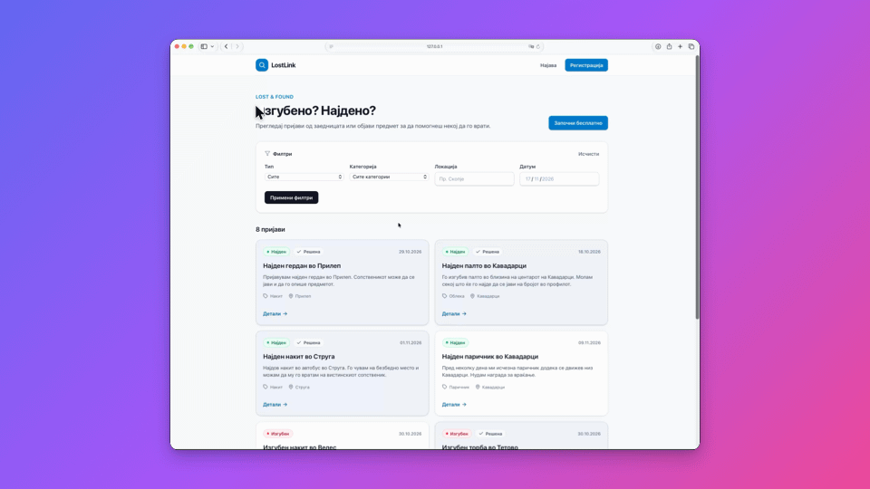
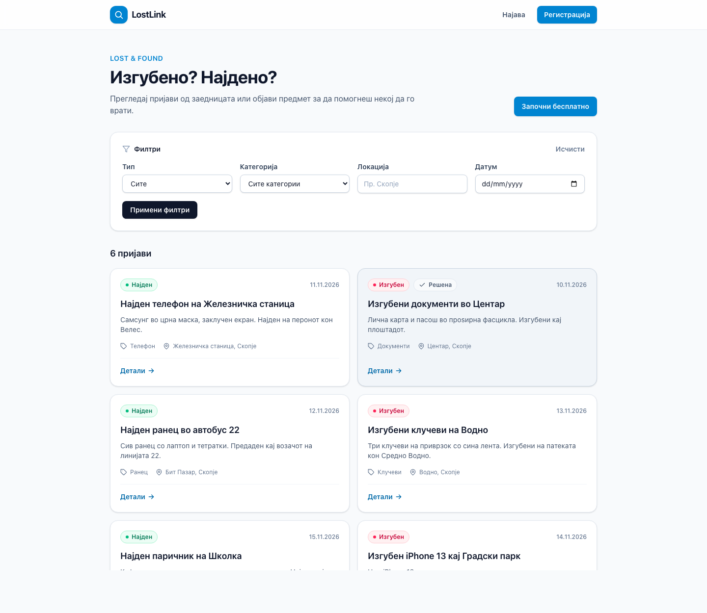
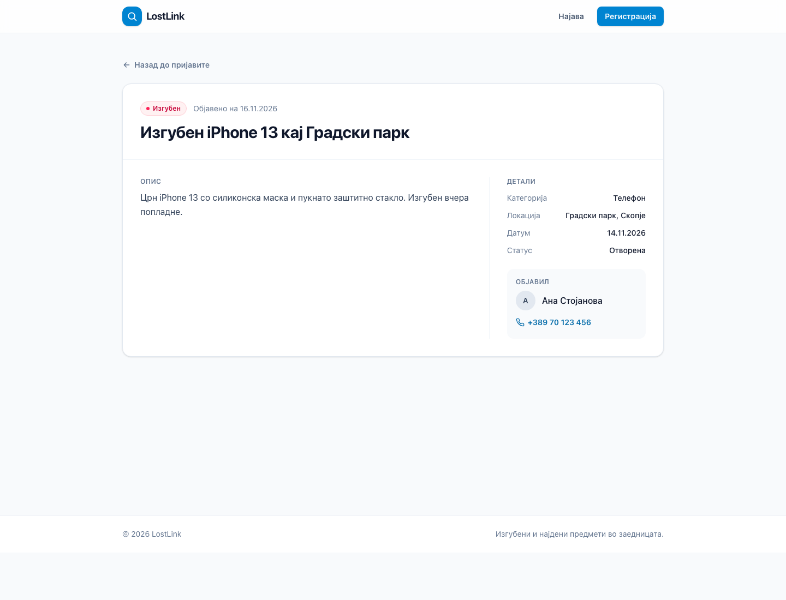

# LostLink

LostLink is a community lost & found platform built with Laravel. People report items they have lost or found, browse and filter nearby reports, and get in touch with the person who posted them. Reports can be marked as resolved once the item is returned, and reports are attributed to their author (`user_id` is nullable and is set to null if that user is deleted).

The project is a full-stack Laravel application (Blade + Tailwind) with a token-authenticated JSON API, PostgreSQL storage, and Geoapify-powered location autocomplete. It is also the project I use to practise AI-assisted development with Laravel Boost, tests, and static tooling.

## What it solves

Losing a wallet, phone, or set of keys usually ends up in scattered social media posts that disappear after a few days. LostLink keeps those reports in one place: structured by type, category, location, and date, searchable, and attributed to a real author with contact details.

## Features

- Session-based registration and login (name, email, phone, password).
- Create, edit, and delete lost/found reports with an optional image.
- Report types (`lost`, `found`), fixed category list, and open/resolved status.
- Location autocomplete backed by the Geoapify geocoding API (Macedonia).
- Filters for type, category, location, and date, with pagination.
- "My reports" page for the authenticated user.
- Authors can resolve/reopen their own reports.
- Ownership-based authorization through a policy.
- JSON API with Sanctum personal access tokens for mobile/partner clients.
- Rate limiting on login, public API reads, authenticated writes, and location search.
- PostgreSQL query indexes, including a trigram index for location search.
- Database check constraints for enum-backed columns and transactional writes.

## Demo



Watch the project demonstration on YouTube:

[▶ Watch Demo Video](https://www.youtube.com/watch?v=qBZ-2yhUj6M)

## Screenshots

| Reports list and filters | Report details |
| --- | --- |
|  |  |

## Tech stack

| Layer | Technology |
| --- | --- |
| Language | PHP 8.3+ (tested on 8.5) |
| Framework | Laravel 13 |
| Authentication | Session guard (web), Laravel Sanctum (API) |
| Database | PostgreSQL (SQLite in-memory for tests) |
| Frontend | Blade, Tailwind CSS 4, Vite 8 |
| Testing | Pest 4 |
| Code style | Laravel Pint |
| External service | Geoapify Geocoding API |

## Project structure

```
app/
├── Enums/                  ReportType, ReportCategory, ReportStatus
├── Http/
│   ├── Controllers/        Web controllers (auth, reports, location search)
│   │   └── Api/            Token-authenticated API controllers
│   ├── Requests/           StoreReportRequest, UpdateReportRequest validation
│   └── Resources/          ReportResource (API serialization)
├── Models/                 User, Report
├── Policies/               ReportPolicy (owner-only update/delete)
└── Services/               GeoapifyService (location autocomplete + caching)
database/
├── factories/              UserFactory, ReportFactory
├── migrations/             Schema, indexes, and check constraints
└── seeders/                DatabaseSeeder
resources/
├── css/app.css             Tailwind entry point
└── views/
    ├── auth/               Login and registration
    ├── components/         Blade components (type badge)
    ├── layouts/            App layout
    └── reports/            Index, create, edit, show, my reports, partials
routes/
├── web.php                 Session-based web routes
├── api.php                 Sanctum-protected JSON API
└── console.php             Console routes
tests/
├── Feature/                HTTP, API, authorization, and integration tests
│   └── Api/
└── Unit/                   Unit tests
```

## Data model

- `users` — name, email, phone, password.
- `reports` — `user_id` (nullable, set null on delete), `type`, `category`, `title`, `description`, `location`, `happened_at`, `status`, optional `image`, timestamps.
- `reports` stores `location` as free text; there are no coordinate columns and proximity filtering is not implemented.
- Enum-backed columns are constrained at the database level on PostgreSQL.

Images are stored on the `public` disk and exposed through `storage:link`.

## Getting started

### Quick start

Clone the repository and start the whole application (PHP, PostgreSQL, and built assets) with one command:

```bash
git clone https://github.com/Isen-Osman/LostLink.git && cd LostLink && docker compose up --build
```

Then open `http://localhost:8000`. Migrations run automatically on the first start. Requires Docker with Compose.

### Requirements

- PHP 8.3+ and Composer 2
- Node.js 20.19+ (or 22.12+) and npm
- PostgreSQL 14+ (the `pg_trgm` extension is used for location search)

### Installation

```bash
git clone https://github.com/Isen-Osman/LostLink.git
cd LostLink

composer install
cp .env.example .env
php artisan key:generate

# Configure PostgreSQL and the Geoapify key in .env (see below)
php artisan migrate

npm install
npm run build
```

### Environment variables

| Variable | Purpose |
| --- | --- |
| `APP_URL` | Base URL of the application |
| `DB_CONNECTION` | Set to `pgsql` for PostgreSQL |
| `DB_HOST`, `DB_PORT`, `DB_DATABASE`, `DB_USERNAME`, `DB_PASSWORD` | Database connection |
| `GEOAPIFY_API_KEY` | Geoapify API key for location autocomplete |
| `FILESYSTEM_DISK` | Default disk; report images use the `public` disk |

Without `GEOAPIFY_API_KEY` the autocomplete returns no suggestions, but the location field still accepts free text.

### Running locally

```bash
php artisan serve
npm run dev
```

Or, as a single shortcut after the environment is configured:

```bash
composer run dev
```

### Running with Docker

The repository ships a `Dockerfile` (PHP 8.5 + built assets) and a `docker-compose.yml` with PostgreSQL 17:

```bash
GEOAPIFY_API_KEY=your-key docker compose up --build
```

The application is served at `http://localhost:8000`. On startup the container waits for PostgreSQL, runs migrations, and creates the storage symlink. A named volume keeps uploaded images between restarts, and a second volume persists the database.

Compose uses its own database container (`lostlink` / `secret` on the internal `db` host), so the database settings in your local `.env` are ignored. `GEOAPIFY_API_KEY` can also be provided through the root `.env`, since Compose reads it for variable substitution.

## API

The API lives under `/api`. Authentication uses Sanctum bearer tokens: call `POST /api/login`, then send `Authorization: Bearer <token>` on protected requests.

| Method | Endpoint | Auth | Description |
| --- | --- | --- | --- |
| POST | `/api/login` | No | Exchange email/password for a token |
| GET | `/api/reports` | No | Paginated reports; filters: `type`, `category`, `location`, `happened_at` |
| GET | `/api/reports/{report}` | No | Single report |
| POST | `/api/reports` | Yes | Create a report |
| PUT/PATCH | `/api/reports/{report}` | Yes | Update a report (owner only) |
| DELETE | `/api/reports/{report}` | Yes | Delete a report (owner only) |
| GET | `/api/user` | Yes | Current user |
| POST | `/api/logout` | Yes | Revoke the current token |

Rate limits: 5 requests/minute for login, 60 requests/minute for the reports API, and 30 requests/minute for location search.

### Web routes

| Method | Endpoint | Description |
| --- | --- | --- |
| GET | `/` | Redirects to the reports list |
| GET | `/reports` | Reports list with filters |
| GET | `/reports/{report}` | Report details |
| GET | `/reports/create` | Create form (auth) |
| POST | `/reports` | Store a report (auth) |
| GET | `/reports/{report}/edit` | Edit form (auth, owner) |
| PUT | `/reports/{report}` | Update a report (auth, owner) |
| PATCH | `/reports/{report}/resolve` | Toggle resolved status (auth, owner) |
| DELETE | `/reports/{report}` | Delete a report (auth, owner) |
| GET | `/my-reports` | Reports owned by the current user (auth) |
| GET | `/locations` | JSON location suggestions (public, rate limited) |
| GET/POST | `/login`, `/register`, `/logout` | Session authentication |

## Testing and code style

```bash
php artisan test
vendor/bin/pint
```

- Feature tests cover authentication, registration, report CRUD, authorization boundaries, API responses, and rate limiting.
- The Geoapify service is tested with `Http::fake()`, so no external calls are made in tests.
- Tests run against SQLite in-memory. PostgreSQL-specific migration logic (`pg_trgm` index and check constraints) is skipped on SQLite and should be verified against a PostgreSQL database.

## Database notes

- `reports` has a composite index on `(type, category)`, plus indexes on `category`, `happened_at`, and `user_id`.
- `reports.location` uses a `pg_trgm` GIN index so `ILIKE '%term%'` searches stay fast.
- Enum-backed columns (`type`, `category`, `status`) are protected by PostgreSQL check constraints.
- Report creation and updates run inside `DB::transaction()`.

## AI-assisted development

This project is developed with AI coding agents as part of the workflow:

- `AGENTS.md` and the skills in `.agents/skills` define the conventions and domain guidance agents must follow.
- Laravel Boost provides MCP tools for schema, routes, logs, and version-specific documentation.
- Tests and Pint act as guardrails: AI-generated changes are only accepted after the test suite and formatter pass.
